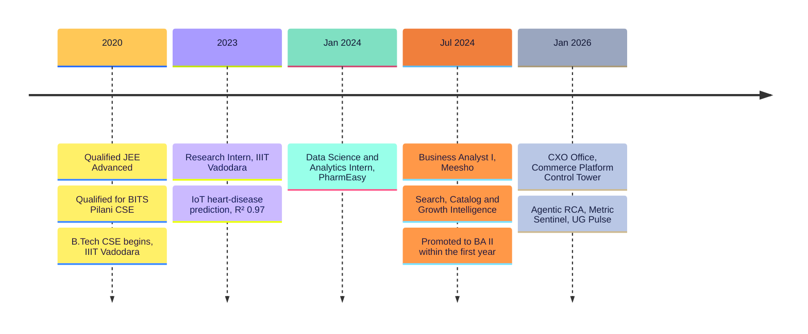
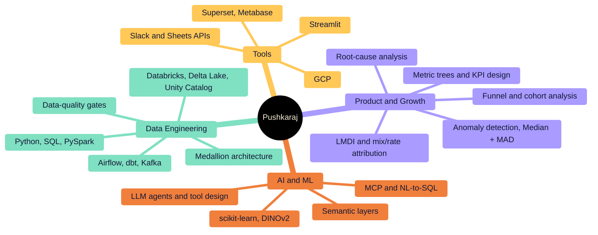

<!-- ===== HEADER ===== -->


<p align="center">
  
</p>

<p align="center">
  <a href="https://linkedin.com/in/pushkaraj-kolekar"></a>
  <a href="mailto:pushkarajkolekar@gmail.com"></a>
</p>


```yaml
role:      Business Analyst II @ Meesho
team:      CXO Office · Commerce Platform Control Tower
owns:      DAU & NMV diagnostics for a 100M+ user marketplace
builds:    agentic RCA · anomaly-to-ticket alerting · certified metric layers
education: B.Tech CSE · Indian Institute of Information Technology Vadodara
```







<details open>
<summary><b>Meesho · Business Analyst II · CXO Office, Commerce Platform Control Tower</b> (Jan 2026 – Present)</summary>
<br/>

- Built an **agentic RCA product on Databricks Genie**: a YAML config-first engine with deterministic date resolution, column-contract validation and a 24-check reconciliation gate. It cut a 1–2 day manual RCA to a 5–10 minute report, now run by 100+ analysts, PMs and GMs.
- Launched **Metric Sentinel**, an autonomous daily alerting loop for GMs. It flags D-1 DAU and Orders/DAU deviations, auto-runs the matching RCA skill, and posts the root cause to Slack with an Andon-style ticket.
- Designed the **KPI-decomposition methods** behind every waterfall (LMDI, mix/rate and counterfactual attribution), reconciling to 100% of a period delta. This attributed ~20% of an AOV decline to a paid-marketing spend cut.
- Shipped **UG Pulse** for the user-growth charter (65M+ DAU, ₹200Cr+ GMV/day), with plan-vs-actual tracking, the full funnel, and Genie drill-through.
- Built a **semantic layer** of 190 metric definitions, distilled from a 738-metric catalogue.

</details>

<details>
<summary><b>Meesho · Central Analytics & Marketplace · Search, Catalog & Growth Intelligence</b> (Jul 2024 – Dec 2025)</summary>
<br/>

- Ran intent clustering over 21M+ queries (+11% orders/visitor, ~1.1% NMV).
- Built a missing-quantity defect classifier over 12M+ products at 97% accuracy (~1.2% NMV).
- Delivered catalog filtering over 100M+ SKUs (+16.2% orders/visitor).
- Was the sole owner of the **Platinum metric layer**, used by 60+ stakeholders and a 7,500+ table catalogue.
- Automated weekly reporting with LLM narratives, cutting it from 2–3 hours to 2–3 minutes and freeing ~45 hours/week across 41 categories.
- Productionized two ML pipelines:
  - a TF-IDF + SGD ticket classifier over 430K tickets
  - DINOv2 image similarity, which replaced a paid image API

</details>

<details>
<summary><b>PharmEasy · Data Science & Analytics Intern</b> (Jan 2024 – Jul 2024)</summary>
<br/>

- Automated recurring ETL and reporting in Python, SQL and Airflow, cutting manual effort by 60% and moving reports from weekly to daily.
- Ran funnel and cohort analysis across 20+ campaigns, which informed how the growth team reallocated spend.

</details>




<p align="center">
  
</p>

<p align="center">
  
  
  
  
  
  
  
  
  
  
</p>


| | Project | Stack | What it does |
|:-:|---|---|---|
| ⚡ | [**BharatCommerce Intelligence**](https://github.com/2pushkaraj3/bharatcommerce-intelligence) | Kafka · Airflow · dbt · Streamlit | Streaming pipeline handling 2M+ events/day; cut latency from **6 hrs to 8 min** |
| 🧩 | [**Prism**](https://YOUR-PRISM-LINK.vercel.app) | LLM agents · Vercel | Multi-agent planner with 5 specialist agents and a "dissent ledger" |
| 🏛️ | [**E-Patrika**](https://github.com/2pushkaraj3/citizen-feedback-system.github.io) | React · Firebase · MongoDB | QR citizen-feedback app shipped in **2 days** for 12+ police stations |


| 🏆 Recognition | 📜 Certifications |
|---|---|
| Outstanding Performance Rating | Google Cloud Career Practitioner |
| Star POD of the Quarter | Deep Learning Fundamentals (NVIDIA) |
| 5-time Meesho Panchayat Award, featured in company newsletter | Database Management Essentials (Coursera) |
| Mentored 4 interns, all 4 converted to full-time | |
| GDSC Cloud Lead: 2 GCP workshops, 92 participants certified | |


<p align="center">
  
  
  
  
  
</p>

<!-- Live CP cards: replace the handles below, then delete this comment line and the closing one.
<p align="center">
  
  
</p>
-->


<p align="center">
  
  
</p>

<p align="center">
  
</p>

<p align="center">
  
</p>

<!-- ===== FOOTER ===== -->

